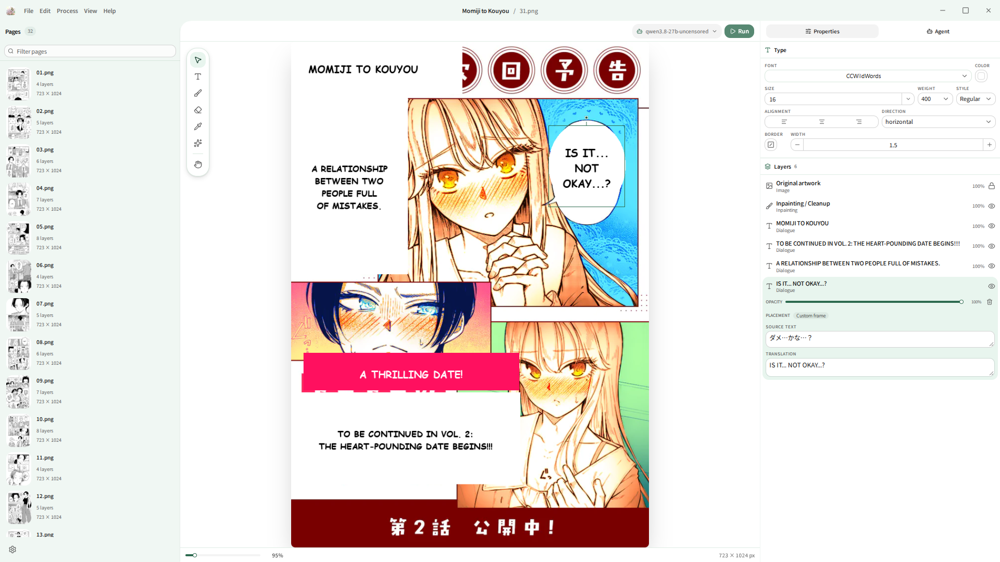
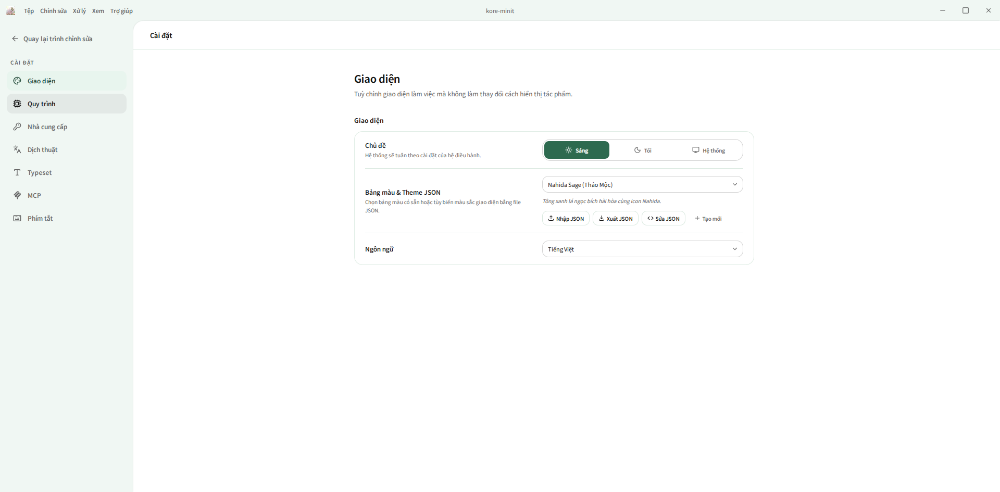

<p align="center">
  
</p>

<h1 align="center">kore-minit</h1>

<p align="center">Local-first manga and comic translation studio, written in Rust and Next.js / Tauri.</p>

<p align="center">
  <a href="https://github.com/chiraitori/koharu/releases/latest"></a>
  <a href="LICENSE-MIT"></a>
  <a href="LICENSE-APACHE"></a>
</p>

---

kore-minit is a desktop application for translating, cleaning, and typesetting manga and comics. It runs detection, OCR, inpainting, and translation models locally on your machine, with optional connections to remote LLM and translation APIs.

## Overview

<p align="center">
  
</p>

## Key Features

- **Project Management**: Import folders, individual raster images, CBZ/CBR archives, and PDFs with multi-page sequencing and saved layer history.
- **Vision Pipeline**:
  - **Text Detection**: RF-DETR segmentation for text balloons, dialogue regions, and sound effects.
  - **OCR**: PaddleOCR VL 1.6, Manga OCR, Baberu OCR, and Hayai OCR.
  - **Inpainting**: Source-text removal and artwork restoration via FLUX.2 Klein, LaMa, RORem, and AOT GAN.
- **Translation Engine**:
  - **Local GGUF Models**: Qwen (3.5 / 3.6 / 3.8), Gemma 4, Ministral 3, and LFM 2.5 via llama.cpp.
  - **Cloud Providers**: OpenAI, Anthropic Claude, Google Gemini, DeepSeek, Grok, MiniMax, Atlas Cloud, and OpenRouter.
  - **Machine Translation APIs**: DeepL, Google Cloud Translation, and Caiyun.
- **WebGPU Canvas**: Hardware-accelerated canvas for manual text adjustment, balloon cleanup, and layer inspection.
- **Typesetting**: Automatic font sizing, bounding-box text fitting, fallback fonts, vertical CJK orientation, and right-to-left layout.
- **Custom JSON Themes**: Built-in palettes (Nahida Sage, Koharu Pink, Midnight Obsidian, Cyber Neon) with support for importing, exporting, and editing custom color schemes via JSON.
- **Model Context Protocol (MCP)**: Built-in MCP client support for external tool integration and agent automation.
- **Layered Export**: Export flattened PNG images or multi-layer PSD files for Adobe Photoshop and Clip Studio Paint.

## Theme Customization

kore-minit includes a JSON theme editor under **Settings > Appearance**. You can select from default palettes, export current color variables, or import custom JSON files.

<p align="center">
  
</p>

## Hardware Acceleration

Graphics driver requirements and supported acceleration backends:

| Backend | Platform | Requirements |
| :--- | :--- | :--- |
| **CUDA** | Windows / Linux | NVIDIA GPU (Turing or newer), driver 580+ |
| **ROCm / HIP** | Linux / Windows | AMD GPU with ROCm support |
| **Metal** | macOS | Apple Silicon (M1 or newer) |
| **Vulkan** | Windows / Linux | Modern GPU with Vulkan 1.2+ support |
| **CPU** | All platforms | Supported as fallback; inference speed is lower |

> [!NOTE]
> The editor canvas uses WebGPU and requires up-to-date graphics drivers even when inference is set to CPU.

## Installation

Download pre-built binaries for Windows, macOS, or Linux from the [Releases page](https://github.com/chiraitori/koharu/releases/latest).

### Windows

Download the `.msi` installer or standalone `.exe` from the latest release assets.

### macOS

Download the `.dmg` installer or `.app.tar.gz` for Apple Silicon or Intel Macs.

### Linux

Download the `.AppImage` or `.deb` package.

## Building from Source

### Prerequisites

- [Rust](https://www.rust-lang.org/tools/install) 1.97 or later (Rust 2024 edition)
- [Bun](https://bun.sh/) 1.3 or later
- [LLVM](https://llvm.org/) / Clang (for native C/C++ model runtime bindings)

### Setup & Run

1. Clone the repository:
   ```bash
   git clone https://github.com/chiraitori/koharu.git
   cd koharu
   ```

2. Install dependencies:
   ```bash
   bun install
   ```

3. Run in development mode:
   ```bash
   bun dev
   ```

4. Build production package:
   ```bash
   bun run build
   ```

Release artifacts will be placed in `target/release`.

## Troubleshooting

Run the executable with `RUST_LOG=debug` to view detailed logging for runtime, model loading, and backend errors:

```bash
# Windows (PowerShell)
$env:RUST_LOG="debug"; .\target\release\kore-minit.exe

# macOS / Linux
RUST_LOG=debug ./target/release/kore-minit
```

## Credits & Upstream

kore-minit is based on [Koharu](https://github.com/koharu-rs/koharu) by Mayo Takanashi and contributors, customized and maintained by [chiraitori](https://github.com/chiraitori).

## License

This project is dual-licensed under the [MIT License](LICENSE-MIT) and the [Apache License 2.0](LICENSE-APACHE).
